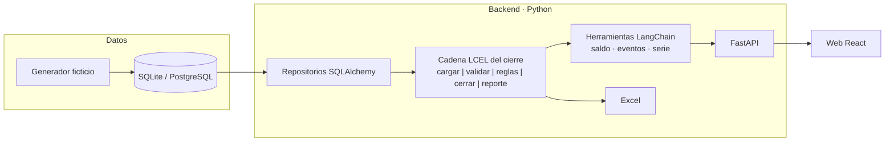

# tempo-ledger

[](https://github.com/jhmaximiliano/tempo-ledger/actions/workflows/ci.yml)

**Banco de horas modelado como libro contable.** Cada solicitud aprobada —horas extra, un
permiso— es un *asiento*; el saldo de cualquier cierre mensual se reconstruye sumando
asientos, y cada número viene con las líneas que lo explican.

> *An hour bank modeled as an accounting ledger: every approved request is an entry, every
> monthly balance is rebuilt from entries and comes with the lines that explain it.*

Proyecto personal de práctica. **Todos los datos son ficticios**: los genera un generador
reproducible y no corresponden a ninguna persona real. El producto **no usa modelos de IA**
([ADR-0009](docs/adr/0009-sin-ia-generativa.md)).

**Estado:** F2 terminada (`v0.2.0`): el motor aplica todas las reglas del libro y el
cierre corre como cadena LCEL. Sigue F3, la API sobre la base. Ver la
[hoja de ruta](#hoja-de-ruta) y el [plan](docs/PLAN.md).

## Reglas del libro

Todo se calcula en **minutos enteros**; las horas son solo una forma de mostrarlo.

| Concepto | Regla |
|---|---|
| **Horas a favor** (horas extra, compensación, recuperación) | Suman en el cierre al que pertenece su fecha |
| **Permisos** (por horas o por días; 1 día = 480 min) | No restan al tomarse: **vencen a los 30 días** (configurable) y restan en el cierre donde cae el vencimiento. Mientras tanto quedan *por vencer* |
| **Vacaciones y licencia médica** | Informativas: no mueven el banco de horas |
| **Aprobación** | Solo cuentan las solicitudes **aprobadas**. Una aprobada después de la fecha efectiva del cierre pasa al cierre siguiente (*fuera de plazo*) |
| **Tardanza** | Entrada después de las 09:00. Hasta 10 min: en tolerancia (informativa). Más de 10 min: no recuperable (va a planilla; no toca el saldo) |
| **Ausencia no regularizada** | Almuerzo de más de 60 min o salida antes de las 18:00 sin permiso que lo cubra. Informativa |
| **Cese** | En el cierre del cese, **finiquito** = saldo − permisos por vencer − tardanza no recuperable |

### El cierre mensual

- **Fecha de corte:** día 25, o el día hábil anterior.
- **Fecha efectiva:** 3 días hábiles después del corte.
- **Ventana:** del corte anterior (exclusive) al corte actual (inclusive).

```
saldo = saldo anterior + horas a favor − permisos que vencen
si saldo < 0  →  se descuenta y el saldo queda en 0
              →  salvo excepción «no descontar» (total o parcial): lo omitido se arrastra
```

| Estado | Cuándo |
|---|---|
| `A FAVOR` | Saldo > 0 |
| `SIN MOVIMIENTO` | Saldo 0, sin asientos |
| `SALDADO` | Saldo 0, con asientos |
| `EN CONTRA` | Saldo < 0, descontado (un cese negativo siempre) |
| `EXCEPCIÓN` | Saldo < 0, no descontado |

## Datos ficticios

El generador ([`data/generator.py`](src/tempo_ledger/data/generator.py)) produce, con la
misma semilla, siempre el mismo conjunto para enero 2025 – diciembre 2026 (24 cierres):

- ~60 empleados con equipo, modalidad, sede, altas y ceses.
- Solicitudes con su flujo de aprobación (pendiente, aprobada, rechazada, anulada).
- Asistencia diaria (entrada, almuerzo, regreso, salida), sin feriados.
- Calendario de cierres y excepciones «no descontar».
- Perfiles de comportamiento (equilibrado, acumulador, deudor, impuntual) y 7 casos borde
  forzados: siempre a favor, deuda grande, aprobación tardía, cese a mitad de mes, ingreso
  reciente, sin movimientos y excepción parcial.

## Ejecutar en local

Requisitos: Python 3.13 y [uv](https://docs.astral.sh/uv/).

```bash
uv sync                          # crea el entorno e instala dependencias
uv run tempo-ledger seed         # migra la base (SQLite por defecto) y la llena
uv run tempo-ledger export       # muestra del conjunto en exports/muestra.xlsx
uv run pytest                    # pruebas
uv run ruff check .              # estilo
```

Opciones: `--seed` y `--employees` en ambos comandos, `--url` en `seed` y `--out` en
`export`.

Para cambiar las reglas, la base o los datos: `cp .env.example .env`, ajustar los valores y
anteponer `--env-file .env` a los comandos (`uv run --env-file .env tempo-ledger seed`).

### API

```bash
uv run uvicorn tempo_ledger.api.app:app --reload   # http://127.0.0.1:8000/docs
```

Al arrancar migra la base y, si está vacía, la llena con datos ficticios: no hace falta
correr `seed` antes. Todos los tiempos van en **minutos**.

| Método | Ruta | Qué devuelve |
|---|---|---|
| `GET` | `/periods` | Calendario de cierres: corte y fecha efectiva |
| `GET` | `/employees` · `/employees/{id}` | Empleados ficticios |
| `GET` | `/closings/{AAAA-MM}` | Saldos del cierre para todos, con estado y totales |
| `GET` | `/closings/{AAAA-MM}/events` | Solicitudes del cierre con su semáforo |
| `GET` | `/employees/{id}/closings/{AAAA-MM}` | La cuenta del cierre paso a paso: líneas, incidencias y explicación |
| `GET` | `/employees/{id}/series?until=AAAA-MM` | El saldo cierre a cierre |
| `POST` | `/requests` | Registra una solicitud (queda pendiente) |
| `POST` | `/requests/{id}/decision` | Aprueba, rechaza o anula una pendiente |
| `GET` | `/requests/{id}` | Una solicitud |

## Funcionalidades previstas

1. **Saldos por cierre**: todos los empleados, con estado y exportación a Excel.
2. **Detalle por empleado**: la cuenta del cierre paso a paso, con los asientos que la explican.
3. **Eventos del cierre**: semáforo aprobado / sin aprobar / fuera de plazo / rechazado.
4. **Serie mensual**: recorrido del saldo con gráfico.
5. **Simulación**: recalcular un cierre con otras fechas de corte o efectiva, sin guardar.
6. **Registro**: alta de solicitudes por la API, con validación de reglas.
7. *(Opcional)* **Buscador del reglamento** con BM25, sin modelo.

## Arquitectura



LangChain (`langchain-core`, LCEL) se usa **solo como marco** para componer el cierre como
una cadena de pasos; ningún paso llama a un modelo
([ADR-0002](docs/adr/0002-langchain-como-marco-sin-modelo.md)).

```
src/tempo_ledger/
  domain/      modelos, catálogos, calendario, asientos, asistencia y motor (Python puro)
  pipeline/    cadena LCEL del cierre: cargar | validar | reglas | cerrar | reporte
  data/        generador ficticio y exportación a Excel
  infra/       tablas SQLAlchemy, conexión, carga de datos y repositorio
  migrations/  migraciones de Alembic
  api/         FastAPI: rutas, contratos y servicio
  cli.py       comandos `seed` y `export`
tests/         reglas caso por caso + invariantes sobre los datos generados
docs/          plan y registro de decisiones (ADR)
```

## Tecnologías

| Área | Elección |
|---|---|
| Backend | Python 3.13 · FastAPI · Pydantic · uv |
| Orquestación | LangChain (`langchain-core`, LCEL), sin modelo |
| Datos | SQLAlchemy · Alembic · SQLite (dev/pruebas) · PostgreSQL (Docker/demo) |
| Web | React · Vite · TypeScript · Tailwind · TanStack Query · Recharts |
| Calidad y CI | ruff · mypy · pytest + cobertura · Vitest · ESLint · pre-commit · GitHub Actions |
| Ejecución y demo | Docker Compose · Render · Neon |

Cada elección tiene su decisión registrada en [`docs/adr/`](docs/adr/).

## Pruebas

Además de casos concretos, las pruebas verifican **invariantes** sobre todo el conjunto
generado: cada cierre cuadra (`saldo = anterior + a favor − vencidos`), el saldo final de un
cierre es el anterior del siguiente, cada asiento se cuenta **exactamente una vez** y el
descuento nunca es negativo. Del generador se verifica, entre otras cosas, que sea
reproducible, que la asistencia caiga solo en días hábiles y que el flujo de aprobación sea
coherente.

## Hoja de ruta

Cada fase cierra con pruebas en verde, PR integrado y una etiqueta de versión.

- [x] **F0** — Plan y ADR.
- [x] **F1** — Modelo de datos (SQLAlchemy + Alembic) y generador ficticio · `v0.1.0`
- [x] **F2** — Motor de reglas y cadena LCEL del cierre · `v0.2.0`
- [ ] **F3** — API sobre la base, herramientas LangChain, Excel y simulación · `v0.3.0`
- [ ] **F4** — Web con las 5 vistas · `v0.4.0`
- [ ] **F5** — Calidad, Docker Compose y CI/CD · `v0.5.0`
- [ ] **F6** — Demo pública en Render + Neon · `v1.0.0`
- [ ] **F7** — *(Opcional)* Buscador del reglamento · `v1.1.0`

Historial de cambios en [CHANGELOG.md](CHANGELOG.md).

## Licencia

[MIT](LICENSE).
