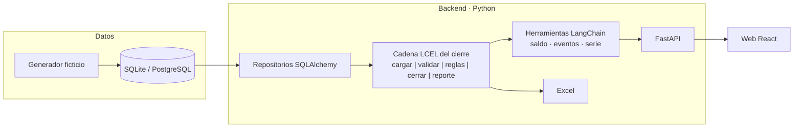

# Plan del proyecto — tempo-ledger

> Estado: **aprobado** (2026-10-26). Nada de lo que describe este plan se
> programa hasta que esté aprobado. Las decisiones técnicas tienen su registro en
> [`docs/adr/`](adr/).

## 1. Objetivo

Un **validador de horas pequeño, propio y publicable**: un banco de horas modelado como
libro contable, con datos ficticios variados y consultas al estilo de un validador de
cierres (saldos por cierre, detalle por empleado, eventos con semáforo, serie mensual,
exportación a Excel, simulación de cierre).

Propósitos: tener un proyecto completo en GitHub, aplicar las tecnologías aprendidas y
practicar el ciclo profesional (plan → ADR → código con pruebas → CI → demo).

**No es objetivo:** usar modelos de IA generativa (sin presupuesto; ver ADR-0009), replicar
reglas o código de ningún sistema real, ni manejar datos reales.

## 2. Reglas del libro (propias)

Todo el cálculo es en **minutos enteros**; las horas solo se muestran.

| Concepto | Regla |
|---|---|
| **Horas a favor** (horas extra, compensación, recuperación) | Suman en el cierre al que pertenece su fecha |
| **Permisos** (por horas o por días; 1 día = 480 min) | No restan al tomarse: **vencen a los 30 días** (configurable) y restan en el cierre donde cae el vencimiento. Mientras tanto quedan *por vencer* |
| **Vacaciones y licencia médica** | Informativas: no mueven el banco de horas |
| **Aprobación** | Solo cuentan las solicitudes **aprobadas**. Una aprobada **después de la fecha efectiva** del cierre pasa al cierre siguiente (*fuera de plazo*) |
| **Cierre mensual** | **Fecha de corte**: día 25 (o el día hábil anterior). **Fecha efectiva**: 3 días hábiles después del corte. La ventana de un cierre va del corte anterior (exclusive) al corte actual (inclusive) |
| **Saldo del cierre** | `saldo = saldo anterior + a favor − permisos que vencen` |
| **Saldo negativo** | Se descuenta y el saldo queda en 0, **salvo** una excepción «no descontar» (total o parcial): lo omitido se arrastra al cierre siguiente |
| **Tardanza** | Entrada después de las 09:00. Hasta 10 min: **en tolerancia** (informativa). Más de 10 min: **no recuperable** (va a planilla; no toca el saldo) |
| **Ausencia no regularizada** | Almuerzo de más de 60 min o salida antes de las 18:00 **sin permiso** que lo cubra. Informativa |
| **Cese** | En el cierre del cese, **finiquito** = saldo − todos los permisos por vencer − tardanza no recuperable. No hay descuento por planilla: se liquida en el finiquito |
| **Estados** | `A FAVOR` (> 0) · `SIN MOVIMIENTO` (0 sin asientos) · `SALDADO` (0 con asientos) · `EN CONTRA` (< 0 descontado; un cese negativo siempre) · `EXCEPCIÓN` (< 0 no descontado) |

Invariantes (se verifican con pruebas sobre todos los datos generados): cada cierre cuadra;
el saldo final de un cierre es el anterior del siguiente; cada asiento se cuenta exactamente
una vez; el descuento nunca es negativo.

## 3. Datos ficticios

Generador reproducible (misma **semilla** → mismos datos), **sin ningún dato real**.

| Dimensión | Qué se genera |
|---|---|
| **Empleados** | ~60, nombre inventado, equipo (Plataforma, Datos, Soporte, Producto, Ventas), modalidad (presencial, remoto, híbrido), sede, fecha de ingreso; **altas y ceses** repartidos en el periodo |
| **Solicitudes** | Horas extra, compensación, recuperación, permiso por horas, permiso por días, vacaciones, licencia médica |
| **Flujo de aprobación** | Pendiente, aprobada, rechazada, anulada; **fecha de registro** y **fecha de aprobación**; una parte aprobada fuera de plazo |
| **Asistencia diaria** | Marcas de entrada, salida a almorzar, regreso y salida por día laborable (feriados excluidos) |
| **Calendario de cierres** | Fecha de corte y fecha efectiva por mes, según las reglas |
| **Excepciones** | «No descontar» total o parcial en algunos cierres |
| **Texto libre** | Motivos y notas variados por solicitud |
| **Reglamento** | Documento Markdown con las reglas del libro (insumo de la fase opcional) |
| **Casos borde forzados** | Siempre a favor, deuda grande, aprobación tardía, cese a mitad de mes, ingreso reciente, sin movimientos, excepción parcial |

**Periodo:** enero 2025 – diciembre 2026 (24 cierres). **Volumen esperado:** ~60
empleados, del orden de 10–20 mil solicitudes y 25–30 mil días de asistencia.

**Punto de control:** el generador se programa primero y produce una **muestra exportada**
(Excel/CSV en una carpeta ignorada por Git) para revisarla antes de seguir.

## 4. Arquitectura

- **Dominio** (`domain/`): modelos y reglas en Python puro, sin dependencias externas.
- **Orquestación** (`pipeline/`): **LangChain `langchain-core` (LCEL)** compone el proceso
  del cierre como una cadena de pasos; las consultas se exponen como `StructuredTool`.
  **Sin modelo de IA** (ADR-0002).
- **Persistencia** (`infra/`): SQLAlchemy + Alembic (ADR-0003).
- **API** (`api/`): FastAPI; documentación automática en `/docs`.
- **Web** (`frontend/`): React (ADR-0005).

## 5. Tecnologías

| Área | Elección | ADR |
|---|---|---|
| Lenguaje y API | Python 3.13 · FastAPI · Pydantic · uv | 0001 |
| Marco de arquitectura | LangChain (`langchain-core`, LCEL), sin modelo | 0002 |
| Base de datos | SQLAlchemy · Alembic · SQLite (pruebas/dev) · PostgreSQL (Docker/demo) | 0003 |
| Datos | Generador propio reproducible | 0004 |
| Web | React · Vite · TypeScript · Tailwind · TanStack Query · Recharts | 0005 |
| Calidad y CI | ruff · mypy · pytest + cobertura · Vitest · ESLint · pre-commit · GitHub Actions · Dependabot | 0006 |
| Ejecución y demo | Docker Compose · Render (API + web) · Neon (PostgreSQL) | 0007 |
| Convenciones | Commits convencionales · SemVer · CHANGELOG · Issues/Projects | 0008 |
| IA generativa | No por ahora (sin presupuesto) | 0009 |
| Observabilidad (opcional) | LangSmith, plan gratuito, para trazar la cadena LCEL | 0002 |

## 6. Funcionalidades

1. **Saldos por cierre**: tabla de todos los empleados con el formato de columnas acordado,
   estado y exportación a Excel.
2. **Detalle por empleado**: la cuenta del cierre paso a paso, con los asientos que la
   explican.
3. **Eventos del cierre**: semáforo aprobado / sin aprobar / fuera de plazo / rechazado.
4. **Serie mensual**: recorrido del saldo con gráfico.
5. **Simulación**: recalcular un cierre con otras fechas de corte/efectiva, sin guardar.
6. **Registro**: alta de solicitudes por la API (validación de reglas).
7. *(Opcional, F7)* **Buscador del reglamento**: LangChain + BM25, sin modelo.

## 7. Fases

Cada fase termina con pruebas en verde, PR integrado y etiqueta de versión.

| Fase | Contenido | Hecho cuando | Versión |
|---|---|---|---|
| **F0** | Este plan y los ADR | Aprobados | — |
| **F1** | Modelo de datos (SQLAlchemy + Alembic) y **generador ficticio** | Muestra exportada y **revisada por el usuario** | v0.1.0 |
| **F2** | Motor de reglas y **cadena LCEL** del cierre | Invariantes en verde sobre todos los datos | v0.2.0 |
| **F3** | API, herramientas LangChain, Excel, simulación | Pruebas de API en verde | v0.3.0 |
| **F4** | Web | Las 5 vistas funcionando contra la API | v0.4.0 |
| **F5** | Calidad, Docker Compose, CI/CD | Un comando levanta todo; CI en verde en cada PR | v0.5.0 |
| **F6** | Demo en Render + Neon, README final con capturas | Demo pública accesible | **v1.0.0** |
| **F7** | *(Opcional)* Buscador del reglamento | Búsquedas relevantes con pruebas | v1.1.0 |

## 8. Riesgos y mitigaciones

| Riesgo | Mitigación |
|---|---|
| La demo gratuita «se duerme» y tarda en despertar | Aviso en la web; aceptable para una demo |
| Límites o vencimiento de los planes gratuitos | Se verifican al llegar a F6; todo corre igual en local con Docker |
| LangChain sin modelo suma una dependencia que Python puro no necesitaría | Solo `langchain-core`; decisión consciente (ADR-0002) |
| Nombres ficticios que coincidan con personas reales | Combinaciones de nombres comunes; aviso en el README |
| Diferencias SQLite/PostgreSQL | Las pruebas de integración también corren contra PostgreSQL en el CI |

## 9. Estado del prototipo existente

El prototipo inicial (motor simple, API en memoria, 25 pruebas) **no está aprobado como
parte del plan**: se revisa contra este documento. El motor y sus pruebas de invariantes son
reutilizables. F1 trajo el generador nuevo (`data/generator.py`) y la base; el generador
viejo (`data/synthetic.py`) y el almacén en memoria (`store.py`) siguen solo porque la API
del prototipo los usa, y se retiran en F3, cuando la API pase a leer la base. Las reglas del
cierre (corte día 25, fecha efectiva, aprobaciones, tardanzas, excepciones, cese) se
amplían en F2.
